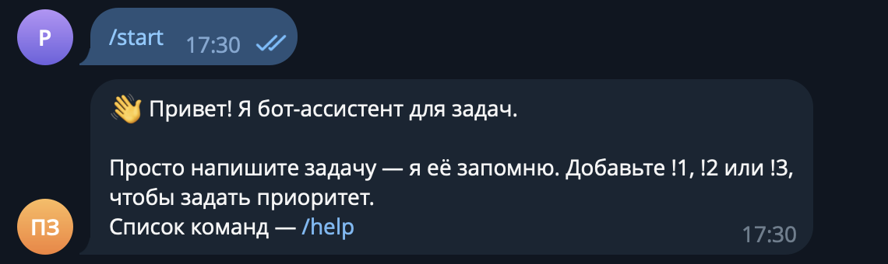
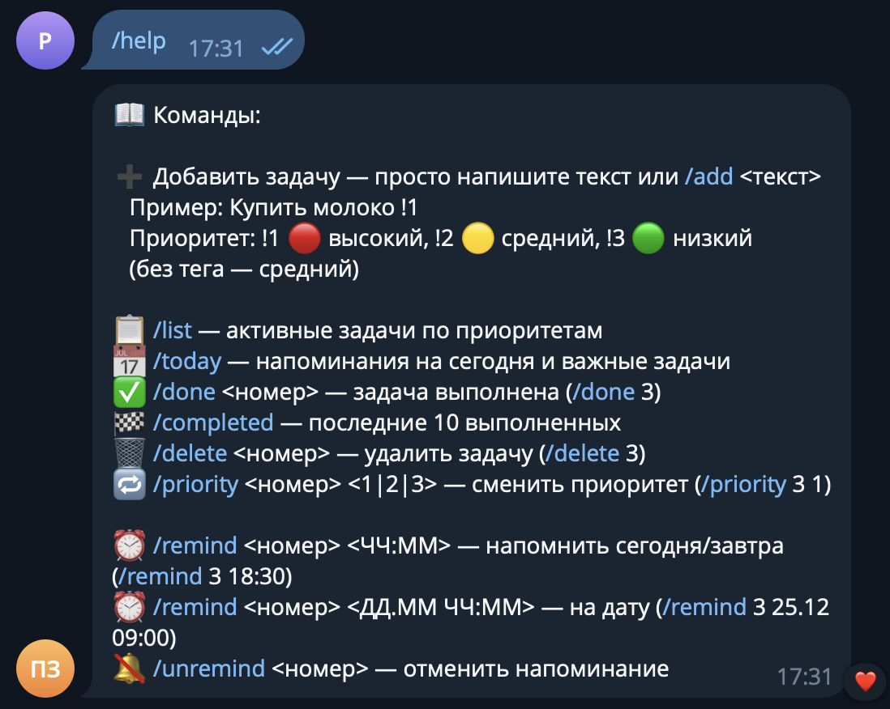

University: [ITMO University](https://itmo.ru/ru/)  
Faculty: [FICT](https://fict.itmo.ru)  
Course: [Vibe Coding: AI-боты для бизнеса](https://github.com/itmo-ict-faculty/vibe-coding-for-business)  
Year: 2026/2027  
Group: U4225  
Author: Kaasamani Roni Bahaaevich  
Lab: Lab1  
Date of create: 13.10.2026  
Date of finished:  

# Лабораторная работа 1. Создание первого Telegram-бота без программирования

Вариант 3 — **бот-ассистент для задач**. Бот: **<USERNAME_БОТА>** (Telegram). Код создан с помощью LLM (Claude), вручную код не писался.

## 1. Описание задачи

### Какую проблему решает бот

Рабочие задачи часто рассыпаны по заметкам, мессенджерам и памяти: их легко забыть, непонятно, что важнее, а напоминания требуют отдельных приложений. Бот собирает задачи там, где человек и так переписывается — в Telegram. Достаточно написать сообщение, чтобы задача сохранилась; приоритет задаётся тегом прямо в тексте, а напоминание приходит в нужное время.

Что умеет бот:

| Функция | Команда |
|---------|---------|
| Принять задачу текстом | любое сообщение или `/add <текст>` |
| Задать приоритет | тег `!1` (🔴 высокий), `!2` (🟡 средний), `!3` (🟢 низкий); без тега — средний |
| Показать задачи по приоритетам | `/list` |
| Задачи на сегодня | `/today` — задачи с напоминанием на сегодня и все задачи высокого приоритета |
| Напоминания | `/remind <номер> <ЧЧ:ММ>` или `/remind <номер> <ДД.ММ ЧЧ:ММ>`, отмена — `/unremind <номер>` |
| Отметить выполненной | `/done <номер>`, история — `/completed` (последние 10) |
| Удалить, сменить приоритет | `/delete <номер>`, `/priority <номер> <1\|2\|3>` |
| Справка | `/start`, `/help` |

Особенности реализации: у каждого пользователя свой список и своя нумерация (номер задачи не меняется после удаления других); данные хранятся в SQLite; неотправленные напоминания восстанавливаются после перезапуска бота; при неверном вводе бот отвечает понятным сообщением и не падает.

### Почему выбрана именно эта задача

- Задача близка к реальной работе руководителя: много поручений, нужны приоритеты и напоминания.
- Функционал понятен без технических пояснений, поэтому хорошо подходит, чтобы научиться формулировать требования к LLM на естественном языке.
- Есть чёткие критерии проверки (команда → ожидаемый ответ), что удобно для тестирования и итераций с LLM.
- Для первой работы это достаточно простой бот (команды, хранение в SQLite, планировщик напоминаний), чтобы довести его до рабочего состояния.

## 2. Промпт для LLM

Полные тексты промптов — в файле [`prompt.md`](prompt.md).

### Исходный промпт

Составлен по шаблону из задания: библиотека `python-telegram-bot`, описание функционала по пунктам (приём задач, приоритеты, `/list`, напоминания, `/today`, `/done`, `/completed`, `/delete`, `/priority`), требования (комментарии на русском, SQLite, обработка ошибок, токен из `.env`, JobQueue с восстановлением напоминаний, часовой пояс из `.env`, логирование) и список создаваемых файлов (`bot.py`, `requirements.txt`, `README.md`, `.env.example`, `.gitignore`). Полный текст — в [`prompt.md`](prompt.md#исходный-промпт).

### Итерации и улучшения

| № | Проблема | Что попросили у LLM | Результат |
|---|----------|---------------------|-----------|
| 1 | На macOS не находились `pip` и `python`; файлы скачались без точки (`env`, `gitignore`); токен не задан | Сделать запуск за пользователя на основе полученных файлов | Скрипт `run.sh`: создаёт venv, ставит зависимости через `python -m pip`, спрашивает токен и пишет `.env`, запускает бота |
| 2 | `telegram.error.TimedOut` на первом запросе к Telegram | Передан текст ошибки целиком | Таймауты увеличены до 30 с; добавлена необязательная переменная `PROXY_URL` (HTTP/SOCKS-прокси); рекомендован VPN |

### Финальный промпт

Исходный промпт плюс дополнительные требования по итогам итераций (скрипт запуска `run.sh`, увеличенные таймауты, поддержка `PROXY_URL`). Полный текст — в [`prompt.md`](prompt.md#финальный-промпт).

## 3. Стек технологий

| Компонент | Что использовано | Почему |
|-----------|------------------|--------|
| Язык | Python 3 (проверено на 3.9 и 3.13) | Самый простой вариант для Telegram-ботов, рекомендован в задании |
| Библиотека бота | `python-telegram-bot` 21.6 (с `job-queue`) | Зрелая библиотека с хорошей документацией; в комплекте асинхронная работа и планировщик `JobQueue` для напоминаний |
| Хранилище | SQLite (файл `tasks.db`, модуль `sqlite3`) | Не требует сервера, входит в стандартную библиотеку, достаточно для личного списка задач |
| Конфигурация | `python-dotenv` (файл `.env`) | Токен и часовой пояс хранятся вне кода и не попадают в репозиторий |
| Часовой пояс | `zoneinfo` + `tzdata` | Корректное время напоминаний по часовому поясу пользователя |
| Прокси | `httpx[socks]` | Позволяет подключаться к Telegram через HTTP/SOCKS-прокси, если сеть блокирует прямой доступ |
| LLM | Claude | Генерация кода и доработки по итерациям |
| Запуск | `run.sh` (bash + venv) | Один скрипт вместо нескольких ручных команд |

## 4. Скриншоты и видео

### Скриншоты работы бота

**`/start` — приветствие**

**`/help` — список команд**

**`/add` — добавление задачи с приоритетом `!2`**

**`/list` — список активных задач по приоритетам**

**`/remind 1 20:00` — установка напоминания**

**`/today` — задачи на сегодня с напоминанием**

**`/done 1` — задача отмечена выполненной**

**`/completed` — список выполненных**

### Видео-демо

Ссылка: <ССЫЛКА_НА_ВИДЕО> (длительность 2–3 минуты).

## 5. Трудности и решения

**1. Запуск на macOS не получился с первого раза.**
В системе нет команд `pip` и `python` (есть только `python3`), файлы скачались без точки в имени (`env`, `gitignore` вместо `.env`, `.gitignore`), а переименовать их в Finder не получалось: имена с точкой в начале Finder не принимает. Токен не был задан.
*Решение:* скрипт `run.sh` — создаёт виртуальное окружение, ставит зависимости через `python -m pip`, при отсутствии токена спрашивает его скрытым вводом и сам создаёт `.env`, затем запускает бота.

**2. Бот падал с ошибкой `telegram.error.TimedOut` при запуске.**
После установки бот запускался, но на первом же запросе к `api.telegram.org` (метод `getMe`) возникал `httpx.ReadTimeout`: сеть не пропускала или сильно задерживала соединение с Telegram.
*Решение:* таймауты соединения увеличены до 30 секунд, добавлена необязательная настройка прокси (`PROXY_URL` в `.env`), а для доступа к Telegram включён VPN. После этого бот подключился и ответил на `/start`.

**3. Работа с токеном.**
Токен бота нельзя хранить в коде и публиковать в Git.
*Решение:* токен читается из `.env`, файл `.env` внесён в `.gitignore`; в репозитории лежит только `.env.example` с заглушкой.

## 6. Выводы

### Что получилось хорошо

- Рабочий бот создан без ручного программирования: LLM сгенерировала весь код по одному структурированному промпту.
- Проверены команды `/start`, `/help`, `/add`, `/list`, `/remind`, `/today`, `/done`, `/completed` — на скриншотах они отвечают ожидаемо.
- Подробный промпт с перечнем функций, требований и файлов дал код, который запустился после настройки окружения.
- Данные хранятся в SQLite, напоминания переживают перезапуск бота, ошибки ввода обрабатываются сообщениями.

### Что можно улучшить

- Добавить кнопки «✅ Выполнено» и «🗑 Удалить» под задачами в `/list`, чтобы не вводить номера вручную.
- Добавить ежедневный дайджест задач (например, в 09:00).
- Задать свои часовые пояса для каждого пользователя (сейчас один общий в `.env`).
- Запустить бота на сервере для постоянной работы (это тема Лаб. 3): сейчас бот работает, пока открыт терминал.
- Автоматические тесты для разбора времени и приоритетов.

### Чему научились

- Формулировать задачу для LLM: перечислять функции, команды, формат ответов, требования к коду и список файлов — чем точнее промпт, тем меньше правок.
- Итеративно улучшать результат: передавать LLM текст ошибки целиком и получать исправление.
- Разворачивать Python-проект: виртуальное окружение, зависимости, переменные окружения, хранение секретов вне репозитория.
- Диагностировать проблемы запуска: отличать ошибки окружения (`pip`, `python`) от сетевых (таймаут Telegram).
