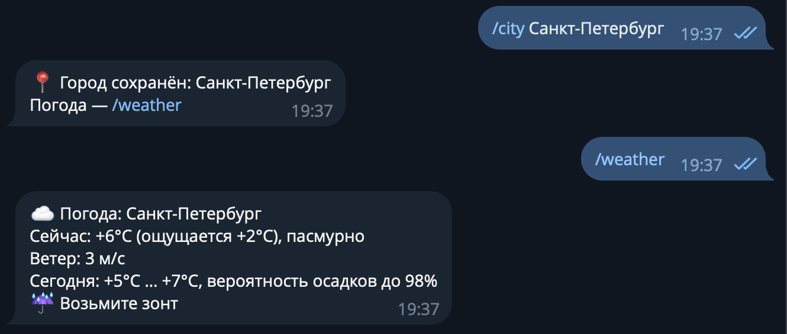

University: [ITMO University](https://itmo.ru/ru/)  
Faculty: [FICT](https://fict.itmo.ru)  
Course: [Vibe Coding: AI-боты для бизнеса](https://github.com/itmo-ict-faculty/vibe-coding-for-business)  
Year: 2026/2027  
Group: U4225  
Author: Kaasamani Roni Bahaaevich  
Lab: Lab2  
Date of create: 13.10.2026  
Date of finished: 13.10.2026  

# Лабораторная работа 2. Подключение бота к данным

Бот из Лаб. 1 — [@itmoftmi_krb_bot](https://t.me/itmoftmi_krb_bot), бот-ассистент для задач. В Лаб. 2 к нему подключены публичный API погоды Open-Meteo и расширенные запросы к SQLite, а также меню команд Telegram. Код создан с помощью LLM (Claude).

## 1. Описание интеграции

### Выбранные источники данных

| Источник | Тип по заданию | Что даёт боту |
|----------|----------------|----------------|
| **Open-Meteo** (геокодинг + прогноз) | Публичный API | Погода в городе пользователя: `/city`, `/weather`, строка погоды в `/today` и в напоминаниях |
| **SQLite** (`tasks.db`) | Простая база данных | Поиск по задачам `/search`, задачи за последние 7 дней `/week`, хранение города пользователя |

Задание допускает несколько источников, поэтому выбраны два: основной — API, вспомогательный — база данных.

### Почему выбраны именно они

- **Погода связана с задачами.** Бот-ассистент помогает планировать день, а погода влияет на планы: «взять зонт», «на улице сильный мороз». Поэтому погода показывается там, где человек уже смотрит на план: в `/today` и в самом напоминании.
- **Open-Meteo не требует ключа и регистрации**, бесплатен для некоммерческого использования, понимает названия городов на русском языке и возвращает всё нужное: температуру, «ощущается как», ветер, осадки и коды погоды.
- **SQLite уже используется ботом**, поэтому поиск и выборка за неделю добавляются без новых зависимостей. Пример «задачи за последнюю неделю» прямо указан в задании.
- **Отклонённые варианты.** Курсы валют (exchangerate.host, CoinGecko) не связаны с задачами. CSV-файл с сотрудниками пришлось бы выдумывать, а к функциям бота он отношения не имеет.

### Структура данных

**Геокодинг** — `GET https://geocoding-api.open-meteo.com/v1/search?name=<город>&count=1&language=ru&format=json`. Реальный ответ для «Санкт-Петербург» содержит поля `name`, `latitude` (59.93863), `longitude` (30.31413), `country` («Россия»), `admin1` («Санкт-Петербург»), `timezone` («Europe/Moscow»). Если город не найден, ключа `results` в ответе нет.

**Прогноз** — `GET https://api.open-meteo.com/v1/forecast` с параметрами `latitude`, `longitude`, `current=temperature_2m,apparent_temperature,precipitation,weather_code,wind_speed_10m`, `daily=temperature_2m_max,temperature_2m_min,precipitation_probability_max`, `wind_speed_unit=ms`, `timezone=auto`, `forecast_days=1`. Структура ответа (значения условные):

```json
{
  "current": {"temperature_2m": 8.4, "apparent_temperature": 5.1, "precipitation": 0.0,
              "weather_code": 3, "wind_speed_10m": 4.2},
  "daily":   {"temperature_2m_max": [9.6], "temperature_2m_min": [3.2],
              "precipitation_probability_max": [20]}
}
```

**База данных SQLite** — к таблицам `tasks` и `counters` из Лаб. 1 добавлена таблица `users`:

| Поле | Тип | Назначение |
|------|-----|------------|
| `user_id` | INTEGER, первичный ключ | Пользователь Telegram |
| `city` | TEXT | Название места, например «Санкт-Петербург» |
| `lat`, `lon` | REAL | Координаты города для запросов прогноза |

## 2. Промпт для LLM

Полные тексты — в файле [`prompt.md`](prompt.md).

### Исходный промпт

Составлен по шаблону курса: описание текущего функционала бота; описание новой интеграции (адреса и параметры обоих API, команды, поведение без заданного города, меню команд); требования (простой код, комментарии на русском, обработка ошибок, таймаут 15 с, кэш 10 минут, поддержка прокси, сохранение функционала Лаб. 1); список файлов (`bot.py`, `weather.py`, `README.md`, автотесты). Полный текст — в [`prompt.md`](prompt.md#промпт-по-шаблону-курса-исходный).

### Итерации и улучшения

| № | Что произошло | Результат |
|---|---------------|-----------|
| 1 | Перед разработкой LLM сравнила источники и предложила план: Open-Meteo + расширение SQLite. Пользователь план утвердил и решил, что без заданного города бот просит `/city`, а не подставляет город по умолчанию | Согласованное ТЗ |
| 2 | При самопроверке кода найдена ошибка: адрес прокси `PROXY_URL` читался при импорте модуля, то есть до загрузки `.env`, и значение из файла не применялось бы к запросам погоды | Значение читается при каждом запросе |
| 3 | Реальный API прогноза недоступен из среды разработки, поэтому проверка без сети: написаны автотесты на подставных ответах | 44 теста, все проходят |
| 4 | Запуск на компьютере пользователя: `/city` и `/weather` вернули реальные данные Open-Meteo (Санкт-Петербург, +6°C, пасмурно, вероятность осадков 98%, подсказка про зонт) | Правок кода не потребовалось |

### Финальный промпт

Исходный промпт плюс уточнения по итерациям (чтение `PROXY_URL` при каждом запросе, поведение без заданного города, перечень сценариев для автотестов). Полный текст — в [`prompt.md`](prompt.md#финальный-промпт).

## 3. Реализация

### Как это работает

1. Пользователь вводит `/city Казань`. Бот обращается к геокодингу Open-Meteo, получает координаты и сохраняет их в таблице `users`.
2. `/weather` берёт координаты из базы и запрашивает прогноз. Ответ кэшируется на 10 минут по координатам, поэтому повторные запросы (например, `/today`, затем напоминания) не нагружают API.
3. В `/today` и в текст напоминания добавляется одна строка с погодой. Если API недоступен, бот пишет «Погода сейчас недоступна», а остальной ответ (задачи, напоминание) приходит как обычно.
4. `/search` и `/week` — обычные SQL-запросы к `tasks` с фильтром по пользователю: чужие задачи никогда не показываются.
5. При запуске бот регистрирует меню команд (`set_my_commands`), и Telegram показывает список команд при вводе `/`.

### Структура проекта

| Файл | Назначение |
|------|------------|
| `weather.py` | Запросы к Open-Meteo, кэш, форматирование, подсказки |
| `bot.py` | Команды Telegram, SQLite, напоминания (JobQueue), меню команд |
| `test_logic.py` | 44 автотеста на подставных данных |
| `run.sh`, `requirements.txt`, `.env.example`, `README.md` | Запуск и конфигурация |

### Ключевые фрагменты кода

**Запрос к API с обработкой ошибок** (`weather.py`): любые сетевые сбои превращаются в понятное пользователю сообщение.

```python
async with httpx.AsyncClient(timeout=REQUEST_TIMEOUT, proxy=proxy) as client:
    response = await client.get(url, params=params)
    response.raise_for_status()
    return response.json()
...
except httpx.TimeoutException:
    raise WeatherError("⏳ Сервис погоды не ответил вовремя. Попробуйте позже.")
```

**Кэш прогноза на 10 минут** (`weather.py`):

```python
key = (round(lat, 2), round(lon, 2))
cached = _cache.get(key)
if cached and time.time() - cached[0] < CACHE_TTL:
    return cached[1]
```

**Поиск по задачам без учёта регистра для кириллицы** (`bot.py`): встроенный `LOWER()` в SQLite не понимает кириллицу, поэтому подключена своя функция, а служебные символы `%` и `_` экранируются.

```python
conn.create_function("py_lower", 1, lambda value: value.lower() if value else value)
...
"SELECT * FROM tasks WHERE user_id = ? AND py_lower(text) LIKE ? ESCAPE '\\' ORDER BY num DESC LIMIT ?"
```

**Меню команд** (`bot.py`): список регистрируется один раз при запуске, сбой не останавливает бота.

```python
await application.bot.set_my_commands(BOT_COMMANDS)
await application.bot.set_chat_menu_button(menu_button=MenuButtonCommands())
```

### Использованные библиотеки

| Библиотека | Зачем |
|------------|-------|
| `python-telegram-bot` 21.6 | Telegram-бот, JobQueue для напоминаний |
| `httpx` (входит в `python-telegram-bot`) | Асинхронные запросы к Open-Meteo: не блокируют работу бота, поддерживают таймауты и прокси; новых зависимостей не потребовалось |
| `sqlite3` (стандартная библиотека) | Хранение задач и города пользователя |
| `python-dotenv` | Токен и настройки из `.env` |
| `unittest` (стандартная библиотека) | Автотесты |

## 4. Тестирование

### Автоматические тесты

`python -m unittest -v test_logic` — **44 теста, все пройдены**. Сеть не нужна: ответы API подменяются заглушками, база создаётся во временном файле. Покрыто:

- геокодинг: город найден, не найден (нет ключа `results`), пустое и слишком длинное название, сломанный ответ;
- прогноз: разбор ответа, кэш (второй вызов не обращается к API), истёкший кэш, отсутствующая вероятность осадков, неожиданный формат ответа;
- сетевые ошибки: таймаут, код 500, обрыв соединения, невалидный JSON;
- `/search`: кириллица без учёта регистра, чужие задачи не видны, выполненные задачи, спецсимволы `%` и `_`, пустой запрос;
- `/week`: фильтрация по дате, пустой результат;
- `/today` и напоминания: с погодой, без города, при недоступном API (задачи и напоминание всё равно приходят);
- меню команд: все команды имеют обработчик, корректные имена и описания, сбой регистрации не останавливает бота;
- функционал Лаб. 1 не сломан.

### Примеры запросов и ответов

| Запрос | Ответ бота |
|--------|------------|
| `/city Нигденск` | 🔎 Город «Нигденск» не найден. Проверьте название и попробуйте ещё раз. |
| `/weather` (город не задан) | 📍 Сначала задайте город: /city Москва |
| `/search` | ❌ Что искать? Пример: /search молоко |
| `/search несуществующее` | 🔎 По запросу «несуществующее» ничего не найдено. |
| `/today` при недоступном API | 🌡 Погода сейчас недоступна. (и далее задачи на сегодня) |

### Скриншоты работы бота (реальный API)

**`/city Санкт-Петербург` и `/weather`** — бот нашёл город через геокодинг и показал данные Open-Meteo: +6°C (ощущается +2°C), пасмурно, ветер 3 м/с, за день +5°C … +7°C, вероятность осадков до 98%, подсказка «Возьмите зонт».



**`/add` без текста (сообщение об ошибке), `/add установить n8n` и `/search n8n`** — обработка ошибки ввода и поиск по задачам в SQLite.


### Видео-демо

Ссылка (Google Drive): [видео-демо работы бота](https://drive.google.com/file/d/1-9vJ3noZhtvydN7-cOkMD5FQtzr5Dc5U/view?usp=sharing)

## 5. Трудности и решения

**1. Реальный API недоступен из среды разработки.**
Запросы к `api.open-meteo.com` из среды, где писался код, блокируются, поэтому проверить прогноз вживую при разработке было нельзя.
*Решение:* логика проверена автотестами на подставных ответах; формат запросов сверен с документацией Open-Meteo. Живая проверка выполнена при запуске бота на компьютере пользователя: `/city` и `/weather` вернули реальные данные без правок кода.

**2. Адрес прокси из `.env` не применялся бы к запросам погоды.**
Значение `PROXY_URL` читалось при импорте модуля `weather.py`, то есть до того, как `bot.py` загрузит `.env`.
*Решение:* значение читается при каждом запросе.

**3. Поиск не находил задачи с другим регистром.**
Встроенная функция `LOWER()` в SQLite работает только с латиницей, поэтому «молоко» не находило «МОЛОКО».
*Решение:* подключена собственная функция `py_lower`; служебные символы `%` и `_` экранируются, чтобы искались как обычный текст.

**4. Особенности ответа Open-Meteo.**
Если город не найден, в ответе геокодинга нет ключа `results`, а вероятность осадков может прийти как `null`.
*Решение:* оба случая обработаны (понятное сообщение и значение 0), добавлены тесты.

**5. Сбой погоды не должен ломать бота.**
Погода — дополнение к основным функциям, а напоминание о задаче важнее.
*Решение:* при ошибке API в `/today` показывается «Погода сейчас недоступна», напоминание отправляется без строки погоды.

**6. Два экземпляра бота с одним токеном.**
Telegram разрешает только одному процессу получать обновления, поэтому бот из Лаб. 1 нужно остановить перед запуском бота Лаб. 2.
*Решение:* предупреждение добавлено в `README.md`.

## 6. Выводы

### Что получилось хорошо

- Бот подключён к реальному API: погода показывается в `/weather`, `/today` и в напоминаниях, город задаётся командой `/city` через геокодинг.
- Обработка ошибок продумана: город не найден, таймаут, недоступность API, неожиданный формат ответа, пустой запрос. При сбое погоды бот продолжает работать.
- Кэш на 10 минут снижает число запросов к API.
- Поиск по задачам работает для кириллицы без учёта регистра; задачи разных пользователей изолированы.
- Список команд появляется при вводе `/`, справка `/help` обновлена.
- 44 автотеста позволяют менять код, не боясь сломать функционал Лаб. 1.

### Что можно улучшить

- Показывать прогноз на несколько дней и погоду на время напоминания (по часам), а не только на сегодня.
- Автоматический утренний дайджест: задачи на день и погода в заданное время.
- Выбор между несколькими городами с одинаковым названием (сейчас берётся первый результат геокодинга).
- Поиск и фильтры по дате и приоритету, экспорт задач в CSV.
- Запуск на сервере для постоянной работы (Лаб. 3).

### Чему научились

- Подключать публичный API без ключа: читать документацию, подбирать параметры запроса, обрабатывать ответы нестандартной формы.
- Проектировать отказоустойчивую интеграцию: таймауты, кэш, понятные сообщения об ошибках, деградация без потери основных функций.
- Проверять логику без доступа к внешнему сервису с помощью подставных ответов и автотестов.
- Использовать меню команд Telegram, чтобы пользователь видел возможности бота.
