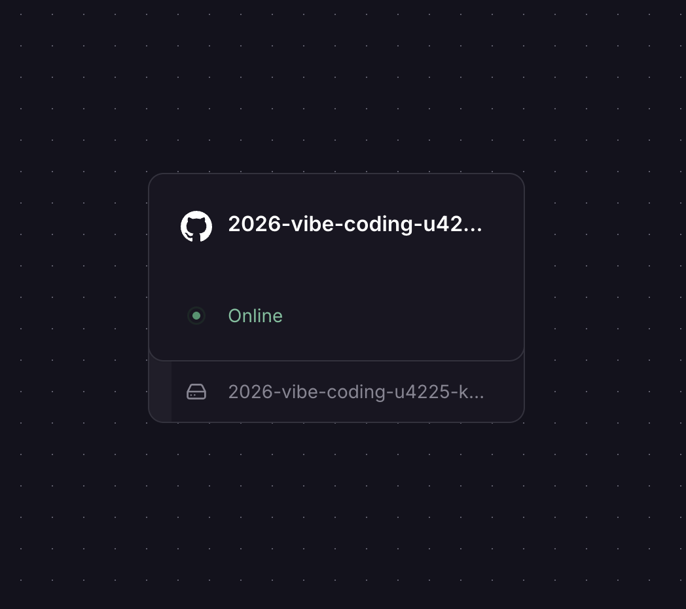
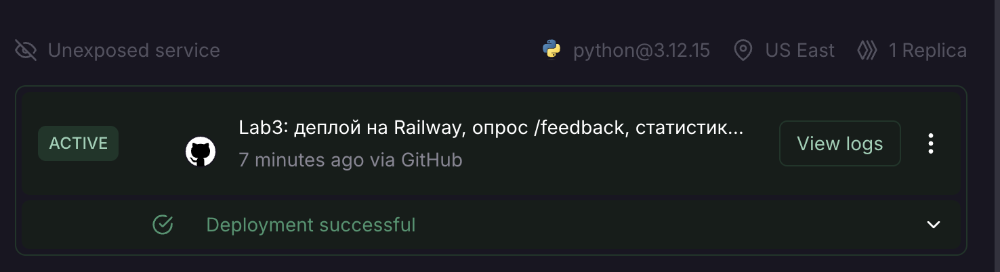
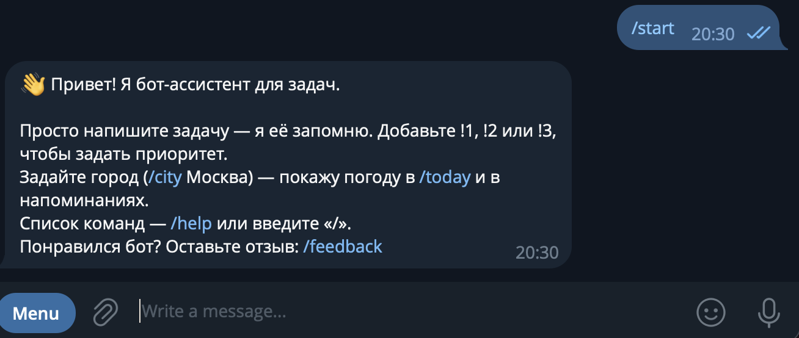
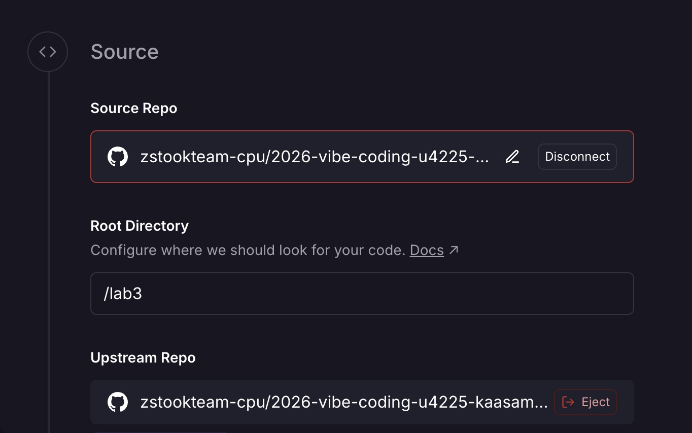
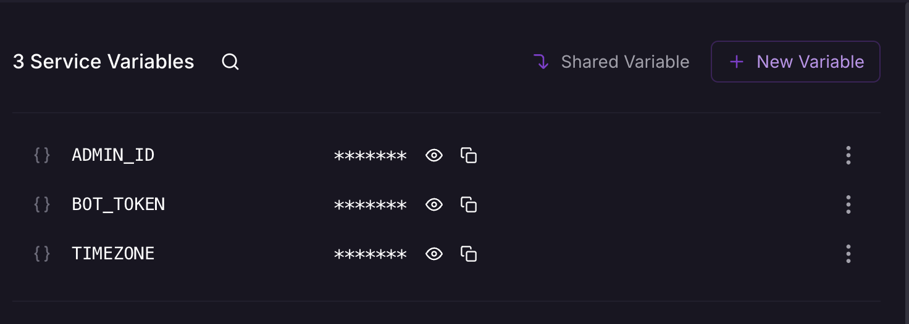
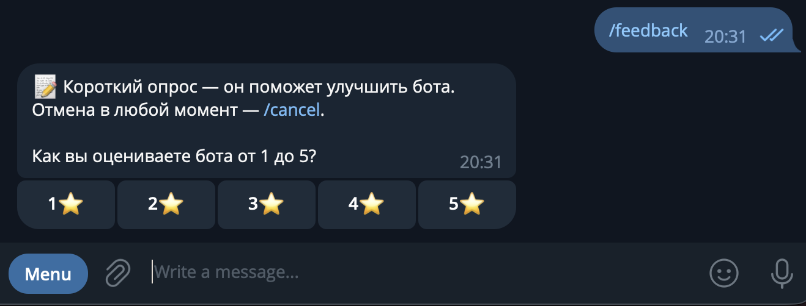
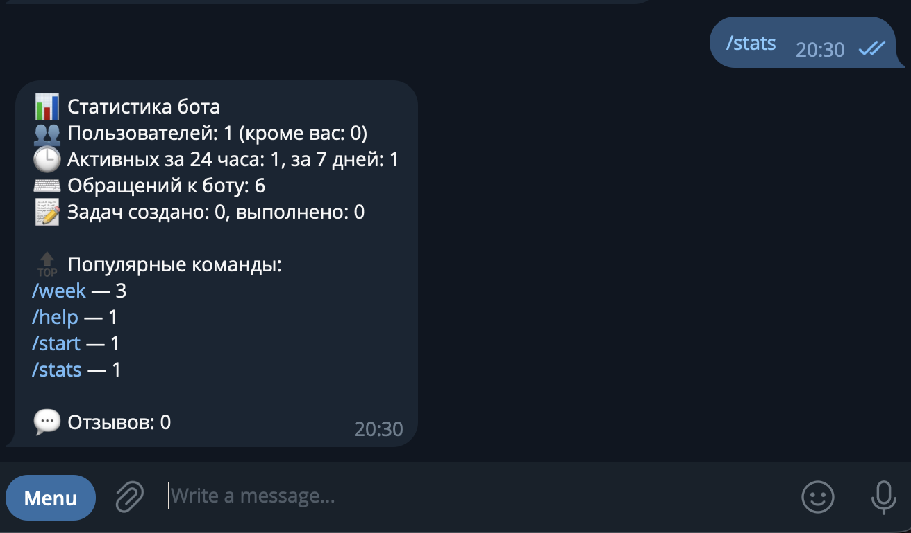

University: [ITMO University](https://itmo.ru/ru/)  
Faculty: [FICT](https://fict.itmo.ru)  
Course: [Vibe Coding: AI-боты для бизнеса](https://github.com/itmo-ict-faculty/vibe-coding-for-business)  
Year: 2026/2027  
Group: U4225  
Author: Kaasamani Roni Bahaaevich  
Lab: Lab3  
Date of create: 13.10.2026  
Date of finished: 13.10.2026  

# Лабораторная работа 3. Запуск бота для реального использования

Бот: [@itmoftmi_krb_bot](https://t.me/itmoftmi_krb_bot) — бот-ассистент для задач (вариант 3) из Лаб. 1–2. В Лаб. 3 он развёрнут на облачном хостинге Railway, в него добавлены сбор обратной связи и статистика, а по отзывам реальных пользователей внесены улучшения. Код создан с помощью LLM (Claude), полные тексты промптов — в [`prompt.md`](prompt.md).

## 1. Описание деплоя

### Выбранный способ и причины

| Параметр | Значение |
|----------|----------|
| Способ | Облачный хостинг **Railway** (один из рекомендованных заданием) |
| Бот | [@itmoftmi_krb_bot](https://t.me/itmoftmi_krb_bot) |
| Режим получения сообщений | Long polling, процесс-воркер (без публичного домена) |
| Исходники | GitHub, папка `lab3` (Root Directory сервиса — `/lab3`) |
| Среда запуска | Python 3.12 (файл `.python-version`), зависимости из `requirements.txt` |
| Команда запуска | `python -u bot.py` (`Procfile` и `railway.json`) |
| База данных | SQLite на Volume Railway, путь `/data/tasks.db` (переменная `DB_PATH`) |
| Настройки | Переменные окружения: `BOT_TOKEN`, `ADMIN_ID`, `TIMEZONE`, `DB_PATH` |

**Почему Railway.** Бот должен работать без компьютера разработчика, а Railway сам собирает проект из GitHub и пересобирает его при каждом пуше, поэтому доставка улучшений сводится к `git push`. Для Telegram-бота выбран polling, а не webhook: не нужен публичный адрес и HTTPS-сертификат, достаточно запущенного процесса. Локальный запуск через ngrok отвергнут из-за зависимости от включённого компьютера, Docker + VPS — как избыточный для учебного бота.

**Что подготовлено в проекте:**
- токен и настройки не лежат в коде: читаются из переменных окружения (локально — из `.env`, он в `.gitignore`);
- в корне репозитория есть `.gitignore` (`.env`, `*.db`, `venv/`, `__pycache__/`, `*.pyc`, `.DS_Store`), в репозиторий не попали служебные файлы;
- есть `requirements.txt` с точными версиями и логирование (`logging`: время, уровень, сообщение);
- ошибки пользователя и неожиданные сбои перехватываются обёртками `safe` и `guard`, бот не падает; сбой записи статистики не ломает обработку команд;
- путь к базе вынесен в `DB_PATH` (каталог создаётся автоматически), чтобы данные лежали на Volume и не пропадали при перезапуске и новых деплоях;
- кэш погоды ограничен 500 записями — расход памяти не растёт со временем;
- новая колонка в базе добавляется миграцией (`ALTER TABLE`), старые данные при обновлении сохраняются;
- автотесты (`python -m unittest -v test_logic`): 61 тест в первой версии деплоя, 91 — после улучшений.

### Результат

Бот развёрнут и отвечает пользователям: [@itmoftmi_krb_bot](https://t.me/itmoftmi_krb_bot).

## 2. Процесс деплоя

Пошаговая инструкция (по ней развёрнут бот):

1. **Остановить локальный бот** (`Ctrl+C`). С одним токеном может работать только один экземпляр, иначе Telegram возвращает ошибку `Conflict`.
2. **Залить проект на GitHub.** Папка `lab3` в репозитории `2026-vibe-coding-u4225-kaasamani_r_b`.
3. **Создать проект в Railway:** New Project → Deploy from GitHub repo → выбрать репозиторий, разрешить Railway доступ к нему.
4. **Указать корневую папку:** сервис → Settings → Source → Root Directory = `/lab3` (репозиторий содержит три лабораторные в разных папках).

   

5. **Задать переменные** (сервис → Variables): `BOT_TOKEN` (токен от @BotFather), `ADMIN_ID` (Telegram ID администратора), `TIMEZONE=Europe/Moscow`, `DB_PATH=/data/tasks.db`. Значения скрыты на скриншоте.

   

6. **Подключить Volume** с точкой монтирования `/data` — на нём лежит SQLite-база.
7. **Дождаться деплоя** (Build → Deploy → Active) и проверить в логах строку «Бот запущен», затем написать боту `/start`, `/stats`, `/feedback`.

Дальнейшие обновления: `git push` в `main` → Railway автоматически пересобирает и перезапускает сервис.

### Возникшие проблемы и решения

| № | Проблема | Причина | Решение |
|---|----------|---------|---------|
| 1 | Деплой падал по кругу с ошибкой `InvalidToken: The token 123456789:replace_with_your_token was rejected` | В переменной `BOT_TOKEN` остался шаблонный токен из `.env.example` | Вписан настоящий токен, сервис пересобран, бот запустился (статус Active, бот отвечает в Telegram) |
| 2 | Сборка образа «зависла» на 7+ минут | Задержка очереди сборки на стороне Railway | Сборка завершилась успешно, деплой перешёл в статус Active |
| 3 | Среди переменных не оказалось `DB_PATH`, хотя Volume подключён | Переменная не была добавлена, база писалась бы в контейнер и терялась при деплое | Добавлена `DB_PATH=/data/tasks.db` |
| 4 | Токен попал на скриншот | Скриншот переменных со вставленным токеном | Скриншоты для отчёта сделаны со скрытыми значениями; токен, попавший на скриншот, рекомендуется перевыпустить в @BotFather (Revoke current token) и обновить `BOT_TOKEN` |
| 5 | Возможная ошибка `Conflict` при двух запущенных ботах | Локальный и облачный экземпляры используют один токен | Перед деплоем локальный бот остановлен |

### Проверка работы

После деплоя в Telegram проверены команды `/start`, `/stats` и `/feedback` (скриншоты выше и в разделе 3); бот отвечает на сообщения. Остальные функции покрыты автотестами. Библиотека обрабатывает сообщения по очереди, данные разных пользователей хранятся раздельно (по Telegram ID), поэтому одновременные обращения не конфликтуют.

## 3. Сбор фидбека

Бот сам собирает отзывы — командой `/feedback` (диалог из 5 шагов), а каждый новый отзыв пересылается администратору. Вопросы совпадают с заданием: оценка от 1 до 5, что понравилось, что не понравилось, что улучшить, будет ли пользоваться дальше.

Для статистики добавлены команды администратора `/stats` (пользователи, активность за 24 часа и 7 дней, популярные команды, средняя оценка) и `/feedbacks` (последние отзывы); они доступны только пользователю с `ADMIN_ID`.

### Как собирали

Бот отправлен четырём пользователям (не администратору) со сценарием проверки на 5–10 минут: добавить задачи с приоритетом, посмотреть `/today`, поставить напоминание, затем пройти `/feedback`. Отзывы приходили администратору сообщениями «Новый отзыв от …» в тот же вечер, 13.10.2026.

### Результаты: 4 реальных пользователя

Имена пользователей не приводятся, чтобы не публиковать личные данные в репозитории. Каждый отзыв оставлен с отдельного аккаунта Telegram и сохранён в базе бота.

| № | Оценка | Понравилось | Не понравилось | Что улучшить | Будет пользоваться |
|---|--------|-------------|----------------|--------------|--------------------|
| 1 | 5⭐ | «Все» | — | — | да, точно |
| 2 | 5⭐ | Удобство расставлять приоритеты у задач | Не понимаю, зачем мне погода | График продуктивности | да, точно |
| 3 | 3⭐ | — | Не вижу смысла в использовании Telegram-приложения, всё держит в календаре | — | нет |
| 4 | 5⭐ | Прозрачное отслеживание целей; выборность приоритета | Нет плана на неделю; хотелось бы видеть список «сегодня», «завтра», «на неделе», «потом» | Ежедневные задачи («полить цветы вечером», «почитать книгу 5 минут») | скорее да |

**Статистика.** Отзывов: 4. Средняя оценка: (5 + 5 + 3 + 5) / 4 = **4,25**. Будут пользоваться: «да, точно» — 2, «скорее да» — 1, «нет» — 1 (3 из 4 настроены положительно).

## 4. Анализ фидбека

### Что понравилось

- **Приоритеты задач** (`!1`, `!2`, `!3`) — отметили два пользователя из четырёх, это самая сильная сторона бота.
- Простота: достаточно написать задачу обычным сообщением; прозрачное отслеживание целей.

### Главные проблемы и запросы

| Запрос из отзывов | Кто | Что это значит |
|-------------------|-----|----------------|
| Погода не нужна | №2 | Погода показывается всем по умолчанию и предлагается в приветствии, хотя для части пользователей лишняя |
| Нужен график продуктивности | №2 | Нет наглядной статистики выполненных задач |
| Всё держу в календаре, бот не нужен | №3 | Бот изолирован от календаря, из-за этого ценность для части аудитории нулевая |
| Нужен план «сегодня / завтра / на неделе / потом» | №4 | Есть `/today` и `/week`, но нет общего плана по срокам |
| Нужны ежедневные (повторяющиеся) задачи | №4 | Напоминание можно поставить только один раз |

Отзыв №1 («Все») не содержит конкретики, поэтому изменений по нему не вносилось.

### Приоритеты улучшений

Приоритет определялся сочетанием трёх критериев: насколько запрос связан с главной задачей бота (планирование), насколько он конкретен и как трудоёмко его сделать без риска сломать существующее.

1. **План по срокам** `/plan` — прямо отвечает на запрос №4, затрагивает основное назначение бота, быстро реализуется на уже имеющихся данных.
2. **Ежедневные задачи** — самый конкретный запрос с понятным сценарием, но требует изменения базы и логики напоминаний.
3. **Экспорт в календарь** — единственный способ ответить на возражение №3: не конкурировать с календарём, а дополнить его.
4. **График продуктивности** `/progress` — запрос №2; реализуем текстовой диаграммой, потому что бот работает в чате.
5. **Погода по желанию** — снимает навязывание функции; исправление небольшое.

## 5. Улучшения

План улучшений согласован с автором до начала разработки; изменения внесены с помощью LLM, затем протестированы и задеплоены (промпт — в [`prompt.md`](prompt.md)).

| № | Отзыв | Что изменено | Проверка |
|---|-------|--------------|----------|
| 1 | №4: план по срокам | Команда `/plan`: сегодня (включая просроченные напоминания), завтра, на неделе (до 7 дней), потом, без срока; внутри группы — по времени и приоритету | Автотесты на группировку, пустой план, изоляцию пользователей |
| 2 | №4: ежедневные задачи | `/remind <номер> daily <ЧЧ:ММ>`: после каждого срабатывания следующее напоминание назначается автоматически. `/done` отмечает день (копия в выполненных, чтобы работала статистика), задача остаётся; `/unremind` останавливает повтор. Миграция базы: колонка `repeat` | Тесты на формат, перепланирование, `/done`, миграцию старой базы |
| 3 | №3: «всё в календаре» | Команда `/calendar` отправляет файл `.ics` с задачами-напоминаниями (ежедневные — с правилом повтора); открывается в Google, Apple и Outlook календарях | Тесты структуры `.ics` (экранирование, перенос строк, `RRULE`), только свои активные задачи |
| 4 | №2: график продуктивности | Команда `/progress`: выполнено по дням за неделю (текстовая диаграмма), доля выполненных, серия дней подряд | Тесты расчёта, серии, пустых данных, изоляции |
| 5 | №2: «зачем погода» | Погода стала необязательной: приветствие и `/today` её не навязывают, `/city off` отключает погоду | Тесты: `/today` без города не упоминает погоду, `/city off` |

Дополнительно обновлены `/help`, `/start` и меню команд Telegram. Количество автотестов выросло с 61 до **91**, все проходят. Новая версия выложена в GitHub (коммит «Lab3: улучшения по отзывам…»); Railway пересобирает сервис автоматически после каждого пуша.

### Как это помогло и повторный фидбек

Все пять запросов из отзывов закрыты в коде и проверены автотестами. **Повторный сбор отзывов о новой версии не проводился**, поэтому утверждать, что улучшения подняли оценки или удержали пользователей, пока нельзя. Это следующий шаг: попросить тех же четырёх пользователей снова пройти `/feedback` и сравнить оценки и ответы «будет ли пользоваться».

## 6. Выводы

**Что получилось хорошо**
- Бот развёрнут на Railway, доступен круглосуточно и обновляется через `git push`.
- Сбор обратной связи встроен в самого бота, а отзывы приходят администратору мгновенно, поэтому не нужны внешние формы.
- За один вечер собрано 4 реальных отзыва со средней оценкой 4,25 и пять конкретных запросов, на которые удалось ответить кодом.
- Обновление не потеряло данные: путь к базе вынесен на Volume, схема меняется миграцией.

**Что можно улучшить**
- Провести повторный опрос после улучшений и сравнить оценки.
- Добавить наблюдение за стабильностью (метрики Railway по памяти и перезапускам за несколько суток) и `healthcheck`.
- Для роста числа пользователей включить обработку сообщений параллельно (`concurrent_updates`) и добавить ожидание блокировки SQLite.
- Рассмотреть интеграцию с календарём в обе стороны, а не только экспорт `.ics`.

**Чему научились**
- Деплой «рабочего» бота отличается от локального запуска: настройки через переменные окружения, постоянное хранилище для базы, один экземпляр на токен, миграции схемы.
- Типичные ошибки деплоя — не код, а конфигурация: шаблонный токен, отсутствие `DB_PATH`, неверная корневая папка.
- Отзывы реальных пользователей дают другие приоритеты, чем собственные идеи: два из пяти запросов (план по срокам и ежедневные задачи) относятся к главной функции бота, а не к «дополнениям».
- Обратную связь нужно запрашивать структурно (оценка и открытые вопросы): так удалось отделить комплименты от конкретных запросов.
- LLM удобно использовать для итераций: сначала согласовать план, затем сгенерировать код и тесты и проверить результат на реальных пользователях.
